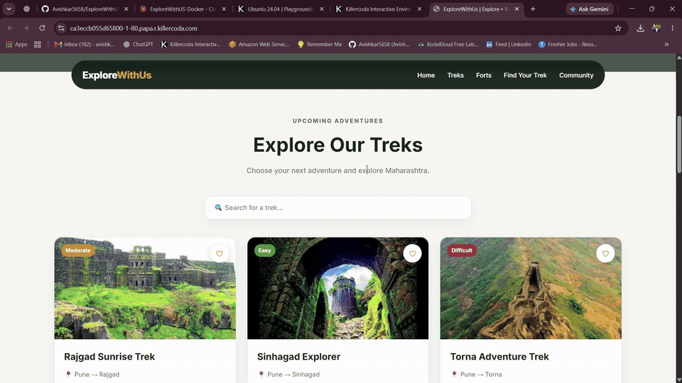
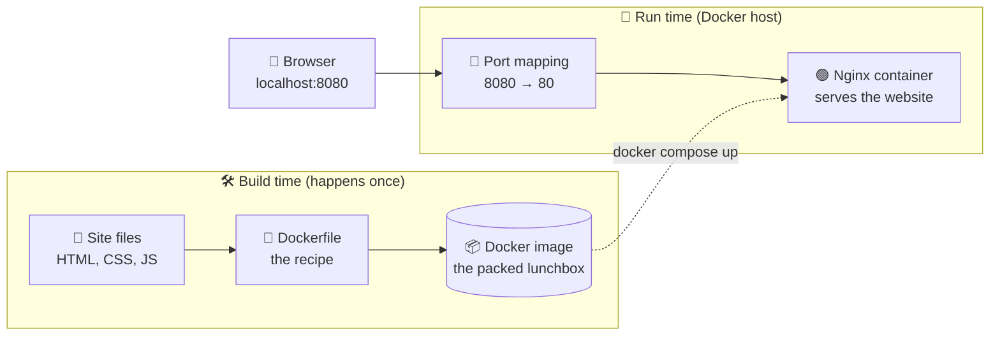
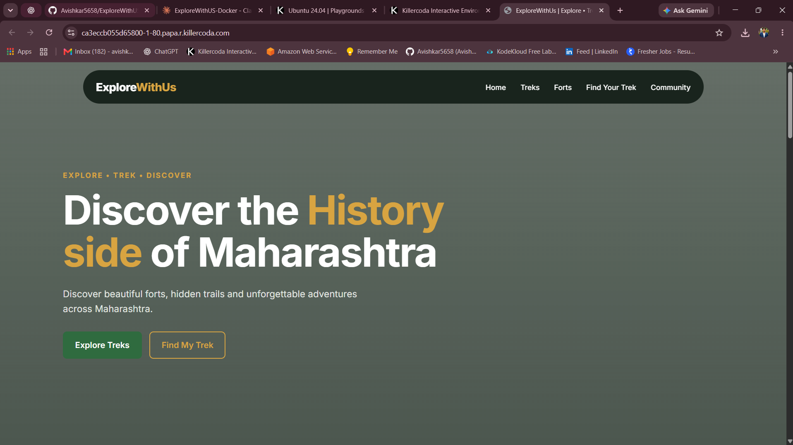
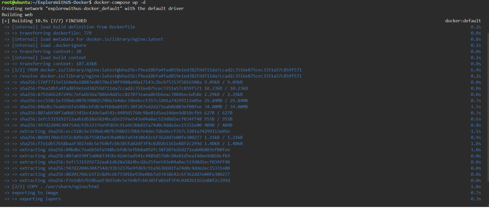
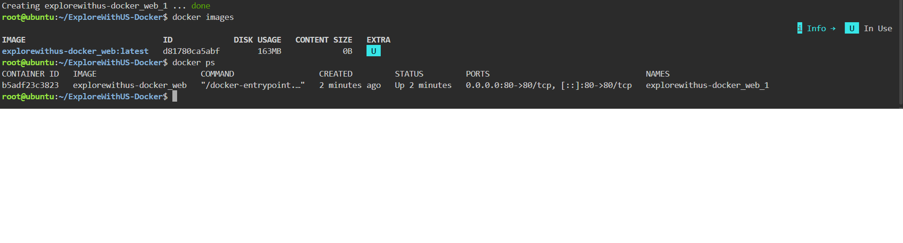
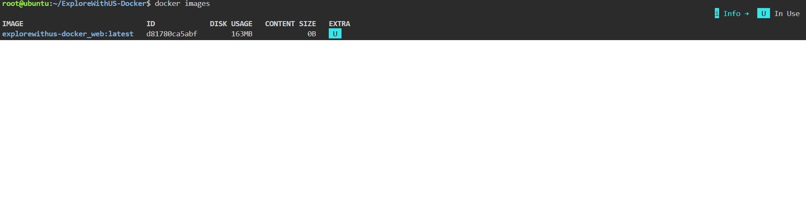

<div align="center">

# 🏔️ ExploreWithUS — Dockerized

### Discover the history side of Maharashtra: forts, hidden trails and unforgettable adventures.
**Packaged in a Docker container, so it runs the same on every computer, with one command.**


<br>



<sub>👆 <b>Live demo:</b> one command starts the container, and the website opens at <code>localhost:8080</code>.</sub>

</div>

---

## 📑 Table of Contents

1. [The Problem (in plain English)](#-the-problem-in-plain-english)
2. [The Solution](#-the-solution)
3. [Architecture](#-architecture)
4. [Tools Used and Why](#-tools-used-and-why)
5. [How It Works](#-how-it-works)
6. [Demo and Screenshots](#-demo-and-screenshots)
7. [Step-by-Step Implementation](#-step-by-step-implementation)
8. [Make a Change and See It Live](#-make-a-change-and-see-it-live)
9. [Challenges and What I Learned](#-challenges-and-what-i-learned)
10. [Cost Note and Cleanup](#-cost-note-and-cleanup)
11. [Future Improvements](#-future-improvements)
12. [Use This Project](#-use-this-project-in-your-own-repo)

---

## 🤔 The Problem (in plain English)

Imagine you build a website on your laptop and it works perfectly. You send it to a friend, and it **breaks on their computer**.

This happens all the time in the software world, and people call it:

> 😅 *"But it works on my machine!"*

**Why does it happen?**

- 😟 Your friend has a different operating system
- 😟 They have different software versions installed
- 😟 Something the app needs is missing, and nobody notices until it crashes

Companies can't afford this. They need software to run **the same way everywhere**: on a developer's laptop, on a test machine and on a real server.

## 💡 The Solution

This project shows **how it's done**, using a tool called **Docker**.

Docker packs the website together with everything it needs into one sealed package called a **container**.

> 🍱 **Lunchbox analogy**
>
> Imagine you pack a lunchbox with food, a spoon and a napkin, everything you need for the meal.
>
> - **Dockerfile** = the *recipe* that says what goes in the lunchbox
> - **Docker image** = the *packed lunchbox*, sealed and ready to travel
> - **Container** = the lunchbox *opened and being used*
>
> Anyone can open the same lunchbox on any table and get exactly the same meal.

| Term | Simple meaning |
|------|----------------|
| 🐳 **Docker** | A tool that packs an app and everything it needs into one portable box |
| 📜 **Dockerfile** | The recipe: a short text file describing how to build the box |
| 📦 **Image** | The finished, sealed box, built from the recipe |
| 🏃 **Container** | The image *running*, like a lunchbox that has been opened |
| 🎼 **Docker Compose** | A one-command "start button" that runs everything using a settings file |
| 🌐 **Nginx** | A fast, lightweight web server that hands the website to visitors |
| 🔌 **Port mapping** | A door that connects your computer (port `8080`) to the app inside the box (port `80`) |

### ✅ Result

**One command starts the whole website**, on any computer with Docker, with no manual setup:

```bash
docker compose up -d
```

---

## 🏗️ Architecture



**How to read the diagram (follow the arrows):**

1. 📄 The **site files** (HTML, CSS, JavaScript) are the website itself.
2. 📜 The **Dockerfile** is the recipe that puts those files into an Nginx web server.
3. 📦 Docker turns the recipe into an **image**, the packed lunchbox.
4. 🏃 **Docker Compose** starts the image as a running **container** and opens a door (port mapping).
5. 👤 A **visitor** types `localhost:8080` in the browser, the request goes through the door, and Nginx sends back the website.

---

## 🧰 Tools Used and Why

| Tool | What it is (simple) | Why it's used here |
|------|---------------------|--------------------|
| **Docker** | Packs apps into portable containers | So the website runs identically on every computer |
| **Dockerfile** | A recipe for building the image | Describes the web server and which files to copy in |
| **Docker Compose** (`compose.yml`) | A settings file plus a start button | Starts the container and sets the port with one command |
| **Nginx** | A lightweight web server | Serves the HTML, CSS and JavaScript to the browser |
| **HTML / CSS / JavaScript** | The building blocks of a website | The content, the design and the interactivity of ExploreWithUS |
| **Git and GitHub** | Version control and online storage | Keeps the project safe, shareable and easy to clone |

---

## ⚙️ How It Works

Everything happens in **four simple stages**:

| Stage | What happens | Command |
|:-----:|--------------|---------|
| **1. Write** 📝 | The website files and a Dockerfile are created | *(already in this repo)* |
| **2. Build** 🛠️ | Docker follows the recipe and creates the image | `docker compose build` |
| **3. Run** 🏃 | Docker starts the image as a container | `docker compose up -d` |
| **4. Visit** 🌐 | You open the address in your browser and see the site | `http://localhost:8080` |

The two small files that make it work:

**`Dockerfile`**: the recipe

```dockerfile
FROM nginx:alpine
COPY index.html style.css script.js /usr/share/nginx/html/
EXPOSE 80
```

**`compose.yml`**: the start button

```yaml
services:
  web:
    build: .
    ports:
      - "8080:80"
    restart: unless-stopped
```

> 💡 `"8080:80"` means: *"when someone knocks on door **8080** of my computer, send them to door **80** inside the container."*

---

## 📸 Demo and Screenshots

### 🎬 One command, one running website

The GIF at the top of this page shows the full flow: starting the container with `docker compose up -d`, checking it with `docker ps`, and opening the website in the browser.

<div align="center">
  
</div>

### 🌐 The website, served from inside a container

<div align="center">
  
</div>

### 🛠️ Step 1: Building the image

Docker reads the Dockerfile and builds the image, the "packed lunchbox".

<div align="center">
  
</div>

### 🏃 Step 2: The container is running

One command starts it, and `docker ps` confirms it is **Up** ✅

<div align="center">
  
</div>

### 🪶 Step 3: A small, lightweight image

Using the **Alpine** version of Nginx keeps the image tiny, so it downloads and starts quickly.

<div align="center">
  
</div>

---

## 🛠️ Step-by-Step Implementation

### ✅ Prerequisites

- [Docker](https://docs.docker.com/get-docker/) installed (Docker Desktop on Windows or macOS, Docker Engine on Linux)
- [Git](https://git-scm.com/downloads) to download the project
- *(Optional)* No Docker on your computer? Use a free online Linux playground such as [Killercoda](https://killercoda.com/) and follow the same steps there.

Check that Docker works:

```bash
docker --version
docker compose version
```

---

### Step 1️⃣ — Download the project

```bash
git clone https://github.com/Avishkar5658/ExploreWithUS-Docker.git
cd ExploreWithUS-Docker
```

---

### Step 2️⃣ — Look at the recipe (optional but recommended)

Open the `Dockerfile` and `compose.yml` and read them. They are only a few lines each, and now you know what every line means from the [How It Works](#-how-it-works) section. 🙂

---

### Step 3️⃣ — Build and start the container

```bash
docker compose up -d --build
```

| Part | Meaning |
|------|---------|
| `up` | Start the app |
| `-d` | Run quietly in the background |
| `--build` | Build the image first |

---

### Step 4️⃣ — Check that it is running

```bash
docker ps
```

You should see a container with the status **Up** ✅

---

### Step 5️⃣ — Open the website 🎉

Go to **http://localhost:8080** in your browser.

> ℹ️ **Using Killercoda or a remote server?** Open port `8080` from the platform's ports/traffic menu, or use the server's public address followed by `:8080`.

---

### ⌨️ Bonus: Run it without Docker Compose

Compose is a shortcut. This is the same thing done manually:

```bash
docker build -t explorewithus .
docker run -d -p 8080:80 --name explorewithus explorewithus
```

---

## 🔄 Make a Change and See It Live

This is where Docker feels powerful. 💪

1. Open `index.html` and change a heading, for example the tagline
2. Save the file
3. Rebuild and restart:

```bash
docker compose up -d --build
```

4. Refresh `http://localhost:8080`. **Your change is live.** ✅

> 💬 **Why this matters:** the whole website is rebuilt from the recipe in seconds, so anyone on any computer gets exactly the same result.

---

## 🎓 Challenges and What I Learned

> ✏️ *Replace the rows below with problems you actually faced. Genuine lessons stand out the most.*

| Challenge | How I solved it |
|-----------|-----------------|
| Page didn't open at `localhost:8080` | Checked `docker ps` and confirmed the port mapping `8080:80` was correct |
| My changes didn't show up after editing | Rebuilt the image with `docker compose up -d --build` |
| "Port is already in use" error | Stopped the other program, or changed the left side of the mapping (for example `8081:80`) |
| Wasn't sure what was happening inside | Used `docker logs` to read the web server's messages |

**Key takeaways**

- ✅ How to write a **Dockerfile** and build an image
- ✅ How **port mapping** connects a container to the outside world
- ✅ How **Docker Compose** replaces long commands with one simple file
- ✅ Why containers make software **portable and repeatable**
- ✅ Basic troubleshooting with `docker ps`, `docker logs` and `docker compose down`

---

## 💰 Cost Note and Cleanup

**This project is free to run.** It only needs Docker on your own computer, and no cloud account is required.

### 🧹 Clean up when you finish

```bash
docker compose down
```

This stops and removes the container. To also remove the image and free disk space:

```bash
docker rmi explorewithus-web
```

> ℹ️ The image name can differ on your machine. Run `docker images` to see the exact name.

---

## 🔮 Future Improvements

- [ ] 🤖 **GitHub Actions** pipeline that builds the image automatically on every commit
- [ ] 🐳 Publish the image to **Docker Hub** so anyone can run it with a single `docker run`
- [ ] ☁️ Deploy the container on **AWS EC2** with a public URL
- [ ] ❤️ Add a **HEALTHCHECK** to the Dockerfile
- [ ] 🔐 Add **HTTPS** with a free certificate
- [ ] 🏗️ Use a **multi-stage build** and a `.dockerignore` file for a leaner image

---

## 🔁 Use This Project in Your Own Repo

Want to try it or add it to your own portfolio?

1. **Fork** this repository (top-right button) or download it as a ZIP
2. Follow the [step-by-step guide](#-step-by-step-implementation) on your own machine
3. Replace the screenshots in `screenshots/` with **your own**
4. Customize the website (text, colors, pages) in `index.html`, `style.css` and `script.js`
5. Write your own **Challenges and What I Learned** section
6. ⭐ If it helped you, give the repo a star!

### 📁 Repository structure

```
ExploreWithUS-Docker/
├── README.md
├── Dockerfile        # The recipe: how to build the image
├── compose.yml       # The start button: how to run the container
├── index.html        # The website's content
├── style.css         # The website's design
├── script.js         # The website's interactivity
└── screenshots/
    ├── 01-website-running.png
    ├── 02-docker-build.png
    ├── 03-compose-up-and-ps.png
    ├── 04-docker-images.png
    └── demo.gif      # Short recording of the website running
```

---

## 👤 Author

**Avishkar Thorave**

[](https://github.com/Avishkar5658)
[](https://www.linkedin.com/in/avishkar-thorve-a77a8b2a1)

---

<div align="center">

⭐ **If you found this useful, give it a star!** ⭐

*Built with 🐳 Docker and a lot of curiosity.*

</div>
